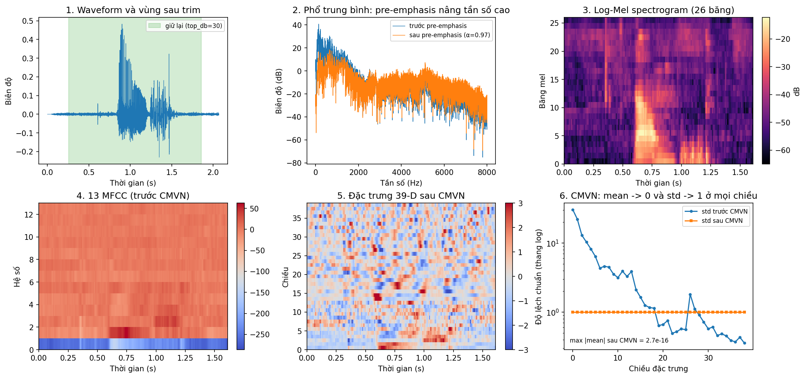
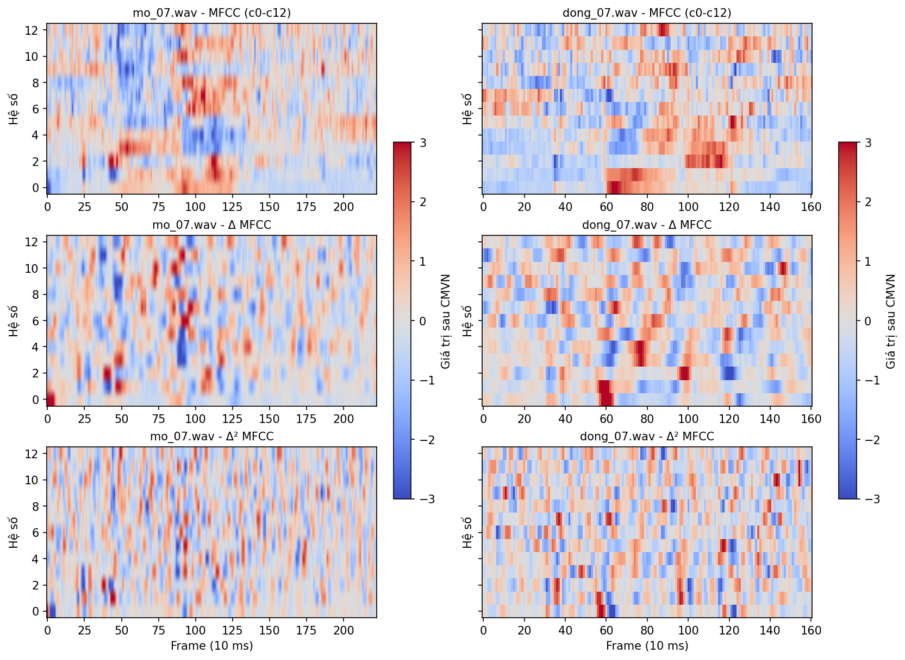
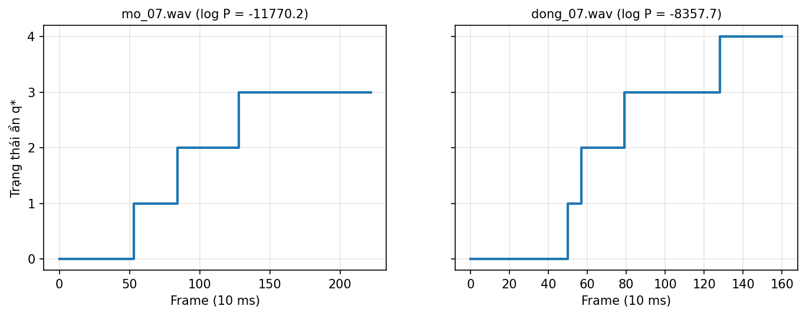
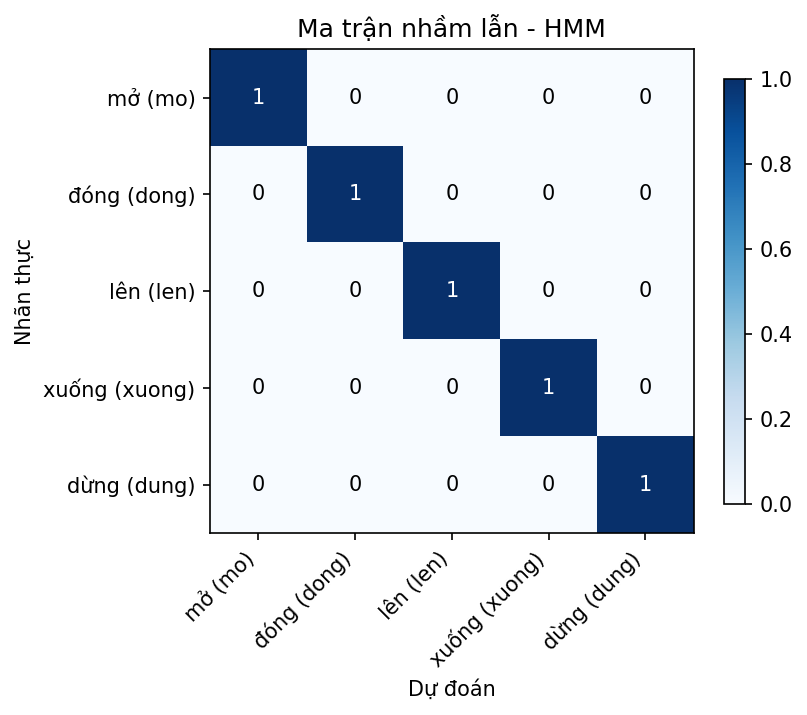

# CSE457 - Lab 3: Nhận dạng Tiếng nói Nâng cao với HMM

Dự án thực hành thuộc học phần **CSE457 – Xử lý âm thanh và tiếng nói** (Bộ môn Trí tuệ nhân tạo, Khoa CNTT, Trường Đại học Thủy Lợi).

Hệ thống nhận dạng 5 từ lệnh tiếng Việt tách rời (`mở`, `đóng`, `lên`, `xuống`, `dừng`) bằng **Whole-word Left-to-Right Gaussian HMM** với đặc trưng động $39$ chiều ($\text{MFCC} + \Delta + \Delta^2$), giải mã **Viterbi**, đối sánh với baseline **DTW (Lab 2)** và thử nghiệm xếp hạng lại bằng **Lexicon + Bigram LM**. Chi tiết kỹ thuật và checklist nằm ở [`SPEC.md`](SPEC.md).

---

## 1. Chạy nhanh

```bash
./run_lab03.sh            # dựng .venv, cài thư viện, chạy toàn bộ pipeline (~30 s)
./run_lab03.sh train eval # hoặc chỉ một số bước
./run_lab03.sh test       # pytest
./run_lab03.sh notebook   # chạy lại Lab03.ipynb và lưu output
```

Kết quả nằm trong `results/` (bảng tổng hợp: [`results/summary.md`](results/summary.md)), mô hình trong `models/`, log trong `results/logs/pipeline.log`. Yêu cầu Python $\ge 3.9$. Đặt `SKIP_SETUP=1` để dùng môi trường đang kích hoạt thay vì `.venv`.

Dùng notebook: `jupyter notebook Lab03.ipynb`. Notebook **không chứa logic xử lý**; mỗi mục gọi `scripts.<bước>.main([...])` rồi trực quan hóa kết quả.

---

## 2. Cấu trúc Thư mục

```text
├── src/                        # Thư viện lõi - mọi logic nằm ở đây
│   ├── config.py               #   đường dẫn, nhãn, FeatureConfig / HMMConfig / LMConfig
│   ├── data.py                 #   liệt kê, kiểm tra WAV, phát hiện rò rỉ train/test
│   ├── features.py             #   trim + pre-emphasis + MFCC/Δ/Δ² + CMVN
│   ├── noise.py                #   nhiễu trắng theo SNR (E5, E6)
│   ├── acoustic.py             #   khởi tạo / huấn luyện / kiểm tra / lưu Gaussian HMM trái-sang-phải
│   ├── decode.py               #   Forward score, Viterbi alignment
│   ├── dtw.py                  #   baseline DTW 1-NN
│   ├── lm.py                   #   lexicon, bigram Add-k, MAP re-ranking
│   ├── rejection.py            #   ngưỡng từ chối (leave-one-out, chỉ dùng train)
│   ├── metrics.py              #   accuracy, confusion matrix, cặp nhầm lẫn
│   ├── experiments.py          #   thí nghiệm E1-E6
│   ├── plots.py, reporting.py  #   biểu đồ và bảng Markdown
│   └── utils.py
├── scripts/                    # Mỗi file là một bước pipeline: python -m scripts.<tên>
│   ├── check_data.py  train.py  evaluate_hmm.py  evaluate_dtw.py
│   └── lm_rerank.py   experiments.py  report.py
├── tests/                      # pytest (dữ liệu tổng hợp, không cần dataset)
├── dataset/
│   ├── train/<label>/          # mo, dong, len, xuong, dung - WAV mono 16 kHz 16-bit
│   ├── test/<label>/           # tách biệt hoàn toàn với train
│   └── test_mismatch/<label>/  # (tùy chọn) người nói khác / mic khác; có thì E5 tự dùng
├── models/                     # hmm_<label>.pkl + meta.json (sinh ra bởi bước train)
├── results/                    # CSV, JSON, PNG, summary.md (sinh ra bởi pipeline)
├── lexicon.txt                 # WORD PHONE_1 ... PHONE_K
├── corpus.txt                  # câu lệnh mẫu để đếm unigram/bigram
├── run_lab03.sh                # điểm vào production
├── Lab03.ipynb                 # chạy từng bước + trực quan hóa + phân tích
├── requirements.txt  pytest.ini
├── SPEC.md                     # đặc tả kỹ thuật và checklist
├── REPORT.md                   # báo cáo phân tích kết quả
└── README.md
```

---

## 3. Pipeline

```text
WAV (16 kHz, mono)
  ──► Trim silence (top_db=30) + Pre-emphasis (0.97)
  ──► 13 MFCC + Δ + Δ² (Hamming 25/10 ms, 26 mel)  ──► CMVN theo utterance  ──► T × 39
  ──► Whole-word Left-to-Right Gaussian HMM (5 trạng thái, diag), Baum-Welch
  ──► Forward log-likelihood (nhận dạng ML)  /  Viterbi (gióng hàng trạng thái)
  ──► Lexicon + Bigram LM: Score(w) = (1/T)·log P_AM(X|w) + λ_LM·log P_LM(w | w_prev)
```

| Bước | Lệnh | Đầu ra |
| :-- | :-- | :-- |
| `check` | `scripts.check_data` | kiểm tra định dạng, số file, rò rỉ train/test |
| `train` | `scripts.train` | `models/*.pkl`, `models/meta.json` |
| `eval` | `scripts.evaluate_hmm` | bảng log-likelihood, confusion matrix, đường Viterbi, ngưỡng từ chối |
| `dtw` | `scripts.evaluate_dtw` | baseline DTW trên cùng đặc trưng/tập dữ liệu |
| `lm` | `scripts.lm_rerank` | bigram, thí nghiệm E6 |
| `exp` | `scripts.experiments` | E1 – E5 |
| `report` | `scripts.report` | `results/*.png`, `results/summary.md` |

Mỗi script nhận tham số riêng, ví dụ `python -m scripts.train --n-states 7`, `python -m scripts.experiments --only E1 E3`.

---

## 4. Kết quả Thực nghiệm

> Số liệu lấy từ lần chạy hiện tại với **6 mẫu train + 1 mẫu test mỗi lớp** (5 utterance test). Với cỡ mẫu này một lỗi làm accuracy đổi 20%, nên chênh lệch nhỏ **không có ý nghĩa thống kê**; phần dưới ghi rõ chỗ nào chỉ là gợi ý. Bảng đầy đủ và tự cập nhật: [`results/summary.md`](results/summary.md); phân tích chi tiết: [`REPORT.md`](REPORT.md).

### 4.1. Tiền xử lý và đặc trưng


Từng bước trên một utterance: trim silence, pre-emphasis (nâng phổ tần số cao), log-Mel, 13 MFCC, đặc trưng 39-D sau CMVN. So sánh đặc trưng của hai từ:



### 4.2. Gióng hàng Viterbi


Đường trạng thái đơn điệu không giảm và đi qua đủ 5 trạng thái; số frame ở mỗi trạng thái cho thấy độ dài tương đối của từng đoạn âm học. Trạng thái cuối là trạng thái hấp thụ nên nhận phần đuôi còn lại của utterance. Ma trận chuyển sau huấn luyện (`results/transmats.png`) vẫn giữ cấu trúc trái-sang-phải (không bước lùi, không nhảy cóc) và cả 5 mô hình hội tụ.

### 4.3. Log-likelihood và ma trận nhầm lẫn

| File test | Nhãn thực | $\lambda_{\text{mở}}$ | $\lambda_{\text{đóng}}$ | $\lambda_{\text{lên}}$ | $\lambda_{\text{xuống}}$ | $\lambda_{\text{dừng}}$ | Dự đoán | Margin |
| :--- | :---: | ---: | ---: | ---: | ---: | ---: | :---: | ---: |
| `mo_07.wav` | `mo` | **-11769.2** | -12494.4 | -13766.3 | -12653.0 | -12805.6 | `mo` | 725.2 |
| `dong_07.wav` | `dong` | -9000.1 | **-8356.3** | -8922.3 | -8942.5 | -8879.7 | `dong` | 523.4 |
| `len_07.wav` | `len` | -8781.2 | -8401.1 | **-7950.6** | -8741.9 | -8461.0 | `len` | 450.5 |
| `xuong_07.wav` | `xuong` | -11609.0 | -11418.1 | -12280.5 | **-10775.5** | -11246.7 | `xuong` | 471.2 |
| `dung_07.wav` | `dung` | -14980.4 | -14577.5 | -15465.3 | -15099.6 | **-13964.5** | `dung` | 613.0 |



Cả 5 mẫu test đúng, margin nhỏ nhất là 450.5 (`len_07.wav`) nên không có mẫu "suýt sai". Ngưỡng từ chối chọn bằng leave-one-out trên train (Youden): $-53.94$ (TPR 0.93, FPR 0.03 trong LOO), chấp nhận 100% mẫu test; phân bố điểm ở `results/score_distribution.png`. Chưa có dữ liệu ngoài từ vựng để đo tỉ lệ từ chối đúng thực tế.

### 4.4. DTW (Lab 2) vs Gaussian HMM

| Chỉ số | DTW (Lab 2) | Gaussian HMM (Lab 3) |
| :--- | :---: | :---: |
| Accuracy (%) | 100.0 | 100.0 |
| Số mẫu train / lớp | 6 | 6 |
| Thời gian train (ms) | 0.01 (chỉ lưu template) | 404.8 (EM) |
| Thời gian test / trial (ms) | 55.3 | 1.13 |
| Cặp từ dễ nhầm nhất | không có | không có |
| Cơ chế alignment | Warping path | Viterbi state path |

HMM đắt ở pha huấn luyện nhưng rẻ hơn nhiều ở pha suy luận: DTW phải so với mọi template (30 so sánh/trial), HMM chỉ chấm 5 mô hình. Hai phương pháp ngang nhau trên tập test sạch; khác biệt chỉ có thể quan sát ở E4.

### 4.5. Thí nghiệm E1 – E6

| Mã | Biến khảo sát | Kết quả (test accuracy) | Nhận xét |
| :-: | :-- | :-- | :-- |
| **E1** | `n_states` ∈ {3, 5, 7} | 100% / 100% / 100% | Accuracy không phân biệt được. LL/frame test cải thiện dần (−53.52 → −52.56 → −52.36) nhưng thời gian huấn luyện tăng (0.15 → 0.38 → 0.57 s) |
| **E2** | 13-D vs 39-D | 100% / 100% | Không có chênh lệch accuracy trên tập test này; LL của hai cấu hình không so sánh trực tiếp được vì khác số chiều |
| **E3** | `diag` vs `full` | 100% / **60%** | `full` overfit: chênh LL train−test là 18.9 so với 1.9 của `diag`, thời gian huấn luyện gấp ~12 lần |
| **E4** | Số mẫu train/lớp | 1: HMM 60% / DTW 64% · 2: 88% / 84% · 3: **100% / 80%** · 4: 100% / 100% · 6: 100% / 100% | Chênh lệch chỉ đáng chú ý ở 3 mẫu (HMM ổn định, DTW dao động ±12.6%); các mức còn lại nằm trong độ lệch chuẩn |
| **E5** | Nhiễu trắng (train sạch) | clean 100% · 20 dB 80% / 80% · 10 dB 60% / 60% · 5 dB 53% / 60% · 0 dB 47% / 47% (HMM / DTW) | Cả hai suy giảm tương đương; không có bằng chứng phương pháp nào bền hơn. Xem lưu ý bên dưới |
| **E6** | $\lambda_{\text{LM}}$ ∈ {0, 0.1, 0.3, 1.0} | clean: 100% mọi $\lambda$ · có nhiễu: thay đổi không đều theo $\lambda$ (vd. 10 dB: 60% → 67% ở $\lambda=1$; 5 dB: 56% → 49–56%) | **Không kết luận được** LM có giúp hay không: tập test sạch đã 100%, còn ở điều kiện nhiễu số trial nhỏ (45, không độc lập vì lặp từ 5 utterance) |

**Lưu ý về E5/E6.** Với `top_db=30` cố định, bước trim không còn cắt được gì khi có nhiễu (hình minh họa ở mục 8 của notebook: file sạch giữ 1.54/2.41 s, mọi mức nhiễu giữ 2.41/2.41 s), nên phần nền nhiễu đi vào HMM và chiếm các trạng thái của từ. Đây là hạn chế của front-end (không có VAD thích nghi hay mô hình im lặng), không phải kết luận về bản thân HMM hay DTW.

---

## 5. Thông tin Tác giả
* **Sinh viên thực hiện:** Nguyễn Văn Minh
* **Mã sinh viên:** 2351260673
* **Lớp:** Trí tuệ Nhân tạo - Khoa Công nghệ Thông tin - Trường Đại học Thủy lợi
* **Giảng viên hướng dẫn:** `[Tên giảng viên]`
