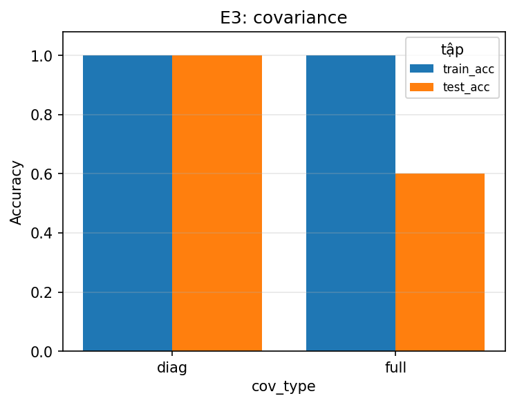
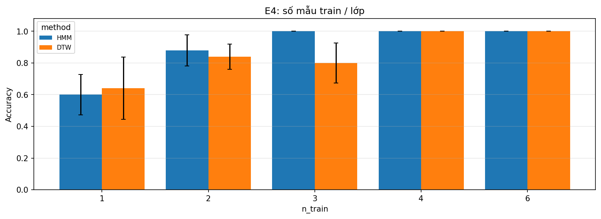
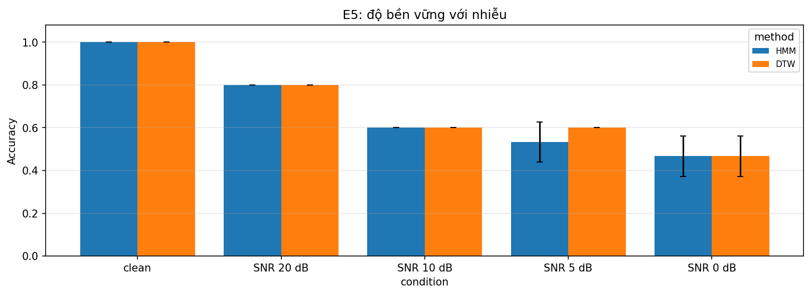
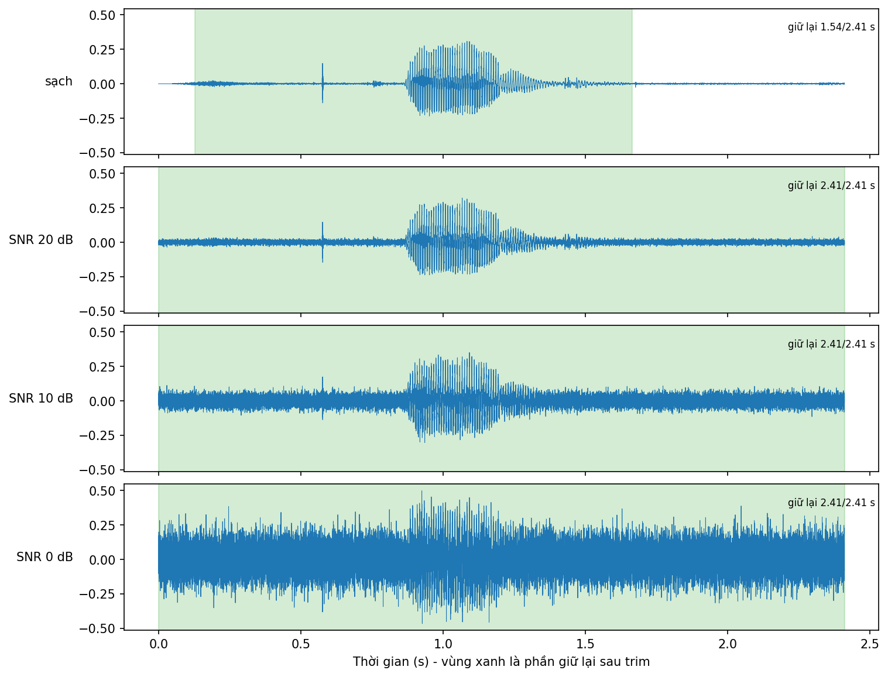

# BÁO CÁO BÀI THỰC HÀNH SỐ 3
## CSE457 • XỬ LÝ ÂM THANH VÀ TIẾNG NÓI
### NHẬN DẠNG TỪ LỆNH TIẾNG VIỆT BẰNG GAUSSIAN HMM

---
* **Họ và tên:** Nguyễn Văn Minh
* **Mã sinh viên:** 2351260673
* **Lớp:** Trí tuệ Nhân tạo - Khoa Công nghệ Thông tin - Trường Đại học Thủy lợi
* **Từ vựng:** 5 từ lệnh tiếng Việt (`mo`, `dong`, `len`, `xuong`, `dung`)
* **Dữ liệu:** 35 file WAV 16 kHz mono 16-bit: **6 train + 1 test mỗi lớp** (30 train / 5 test)
* **Mã nguồn:** [`src/`](src), [`scripts/`](scripts), chạy bằng [`run_lab03.sh`](run_lab03.sh); trực quan hóa trong [`Lab03.ipynb`](Lab03.ipynb)
* **Số liệu đầy đủ:** [`results/summary.md`](results/summary.md)

> **Giới hạn quan trọng.** Tập test chỉ có 5 utterance nên một lỗi làm accuracy đổi 20%. Báo cáo chỉ khẳng định điều gì số liệu thực sự đỡ được và nói rõ chỗ nào không kết luận được.

---

## 1. Dữ liệu và cách chia

Ban đầu mỗi lớp có 5 file train và 2 file test. Để có 6 mẫu train mỗi lớp (đúng khuyến nghị trong `SPEC.md`), file `<label>_06.wav` được chuyển từ test sang train; test còn `<label>_07.wav`. Việc này **đổi lấy** độ tin cậy của đánh giá: tập test giảm từ 10 xuống 5 utterance. Không có rò rỉ train/test (`check_data` so sánh nội dung file bằng SHA-1).

## 2. Phương pháp

| Thành phần | Cấu hình |
| :-- | :-- |
| Tiền xử lý | Trim silence (`top_db=30`), pre-emphasis $\alpha=0.97$ |
| Đặc trưng | 13 MFCC + Δ + Δ² = 39 chiều, Hamming 25/10 ms, 26 mel, CMVN theo utterance |
| Mô hình | Whole-word HMM trái-sang-phải, 5 trạng thái, Gaussian `diag`, Baum-Welch (`n_iter=80`) |
| Khởi tạo | Chia đều mỗi utterance thành 5 đoạn theo thời gian để lấy mean/cov ban đầu |
| Nhận dạng | Forward: $\arg\max_w \log P(X\mid\lambda_w)$; Viterbi để gióng hàng |
| Baseline | DTW 1-NN, cùng đặc trưng 39-D, mọi file train là template |
| LM | Bigram Add-$k$ ($k=0.5$) trên `corpus.txt`, re-rank MAP với $\lambda_{\text{LM}}$ |


Pre-emphasis nâng phổ tần số cao (panel 2); CMVN đưa mean về 0 và std về 1 ở mọi chiều (panel 6), loại bỏ chênh lệch thang đo giữa các chiều (std trước CMVN trải từ ~30 ở $c_0$ xuống dưới 1).

## 3. Kết quả

### 3.1. HMM và gióng hàng Viterbi

Cả 5 mô hình hội tụ (16 đến 45 vòng EM), `transmat_` giữ nguyên cấu trúc trái-sang-phải (không bước lùi, không nhảy cóc). Đường Viterbi đơn điệu không giảm và dùng đủ 5 trạng thái:


Trạng thái cuối là trạng thái hấp thụ nên nhận phần đuôi còn lại của utterance; vì trim chỉ cắt được một phần khoảng lặng nên đoạn đuôi này có thể chứa cả nền. Cả 5 mẫu test đều đúng, margin Top-1 − Top-2 nhỏ nhất là 450.5 (xem bảng ở README, mục 4.3), tức không có mẫu "suýt sai" trong tập này.

### 3.2. So sánh với DTW

| | DTW | HMM |
| :-- | :-: | :-: |
| Accuracy | 100% | 100% |
| Thời gian train | 0.01 ms (chỉ lưu template) | 404.8 ms |
| Thời gian / trial | 55.3 ms | 1.13 ms |

Hai phương pháp ngang nhau về độ chính xác trên tập sạch. HMM tốn thời gian huấn luyện nhưng suy luận nhanh hơn ~50 lần vì chỉ chấm 5 mô hình thay vì so với 30 template bằng quy hoạch động.

### 3.3. Các thí nghiệm

**E1 – số trạng thái (3/5/7).** Accuracy test đều 100%, không phân biệt được. Likelihood test theo frame cải thiện dần nhưng giảm lợi ích (−53.52 → −52.56 → −52.36), trong khi thời gian huấn luyện tăng (0.15 → 0.38 → 0.57 s). Chọn 5 là thỏa hiệp hợp lý, không phải kết luận mạnh.

**E2 – 13-D vs 39-D.** Accuracy cùng 100%; không có bằng chứng ở tập này rằng đặc trưng động giúp ích. Likelihood giữa hai cấu hình không so sánh được vì khác số chiều.

**E3 – `diag` vs `full`.** Đây là kết quả rõ nhất: `full` đạt 100% trên train nhưng chỉ **60%** trên test, chênh likelihood train−test là 18.9 (so với 1.9 của `diag`) và huấn luyện chậm hơn ~12 lần. Với 6 utterance (~300 frame) cho mỗi mô hình 5 trạng thái và ma trận hiệp phương sai 39×39, số tham số vượt xa dữ liệu nên overfit; `diag` là lựa chọn đúng cho cỡ dữ liệu này.



**E4 – số mẫu train mỗi lớp.** Trung bình trên 5 lần lấy mẫu con ngẫu nhiên (có seed):

| Mẫu / lớp | 1 | 2 | 3 | 4 | 6 |
| :-- | :-: | :-: | :-: | :-: | :-: |
| HMM | 60% | 88% | 100% | 100% | 100% |
| DTW | 64% | 84% | 80% | 100% | 100% |



Cả hai cần ≥ 4 mẫu để đạt 100%. HMM đạt 100% từ 3 mẫu và rất ổn định (độ lệch chuẩn 0) trong khi DTW dao động (80% ± 12.6%), nhưng chênh lệch này chỉ ~1.6 độ lệch chuẩn trên 5 mẫu test nên chỉ mang tính gợi ý. Với 1 mẫu thì không bên nào dùng được.

**E5 – nhiễu trắng (mô hình huấn luyện trên dữ liệu sạch).**

| Điều kiện | clean | 20 dB | 10 dB | 5 dB | 0 dB |
| :-- | :-: | :-: | :-: | :-: | :-: |
| HMM | 100% | 80% | 60% | 53% | 47% |
| DTW | 100% | 80% | 60% | 60% | 47% |



Cả hai suy giảm gần như giống nhau; không có bằng chứng phương pháp nào bền hơn. Nguyên nhân chính nằm ở khâu tiền xử lý chứ không ở mô hình:



Với một file ví dụ (`len_07.wav`), file sạch được trim còn 1.54/2.41 s, nhưng ở SNR 20, 10 và 0 dB trim giữ nguyên toàn bộ 2.41 s vì sàn nhiễu vượt ngưỡng −30 dB so với đỉnh. Khi đó HMM (không có mô hình im lặng) buộc phải giải thích đoạn nhiễu bằng các trạng thái của từ, còn DTW so khớp luôn cả phần nhiễu. Cả hai đều chịu cùng một lỗi front-end.

**E6 – trọng số LM.** Trên tập sạch accuracy đã 100% nên LM không có gì để cải thiện. Dưới nhiễu, kết quả thay đổi không đều theo $\lambda$ (ví dụ SNR 10 dB: 60% → 67% ở $\lambda=1$; SNR 5 dB: 56% → 49–56%). Số trial là 45 mỗi điều kiện nhưng lặp từ 5 utterance nên không độc lập; **không kết luận được** LM có cải thiện hay không. Lưu ý thiết kế: mỗi utterance được thử với mọi từ đứng trước nó trong corpus (ngữ cảnh mô phỏng), còn corpus nhỏ nên bigram có xác suất rất nhọn (ví dụ $P(\text{dừng}\mid\text{lên}) = 0.77$).

## 4. Phân tích lỗi và hạn chế

1. **Cỡ mẫu test.** 5 utterance không đủ để phân biệt các cấu hình đều đạt 100% (E1, E2) hay để đo độ lệch giữa HMM và DTW. Cần tập test lớn hơn và nhiều người nói.
2. **Một người nói.** Chưa có `dataset/test_mismatch/` (người nói khác, mic khác); "độ bền vững" mới chỉ được thử bằng nhiễu trắng nhân tạo.
3. **Front-end nhạy với nhiễu.** Trim cố định `top_db=30` mất tác dụng ngay từ SNR 20 dB. Hướng cải thiện: VAD thích nghi theo sàn nhiễu, hoặc thêm mô hình im lặng (silence HMM) hai đầu mỗi từ.
4. **Ngưỡng từ chối** được chọn bằng leave-one-out trên train ($-53.94$, TPR 0.93, FPR 0.03) nhưng chưa có dữ liệu ngoài từ vựng để đo khả năng từ chối thật.
5. **Khởi tạo.** Chia đều theo thời gian ổn định hơn K-means của `hmmlearn` trên dữ liệu này (K-means: 90% ở một seed và suy biến ở seed khác khi một trạng thái không nhận frame nào).

## 5. Phụ lục: câu hỏi lý thuyết

Phần trả lời 10 câu hỏi lý thuyết (Mục 6.1 của đề bài) **chưa được thực hiện** vì đề bài không có trong repo; sẽ bổ sung khi có đề.

## 6. Tái lập

```bash
./run_lab03.sh          # toàn bộ pipeline (~30 s), sinh results/ và models/
./run_lab03.sh test     # 21 test pytest
./run_lab03.sh notebook # chạy lại Lab03.ipynb
```
