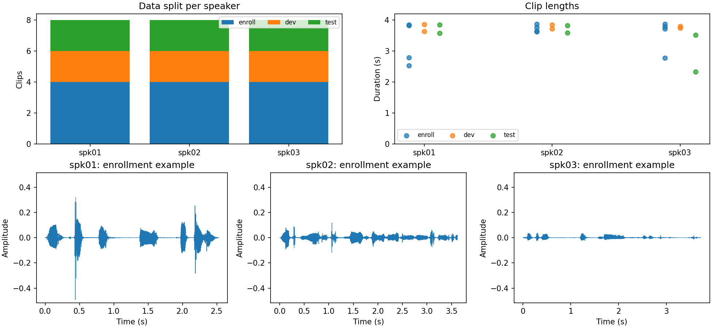
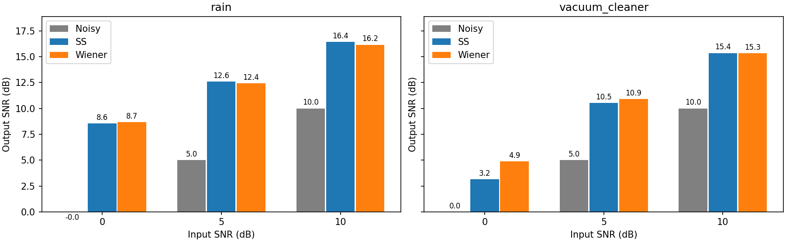
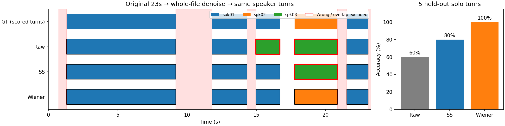
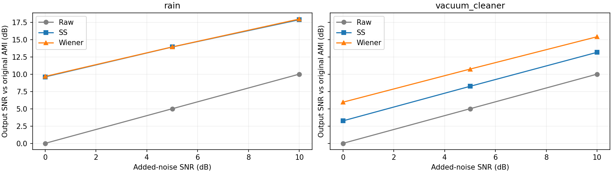
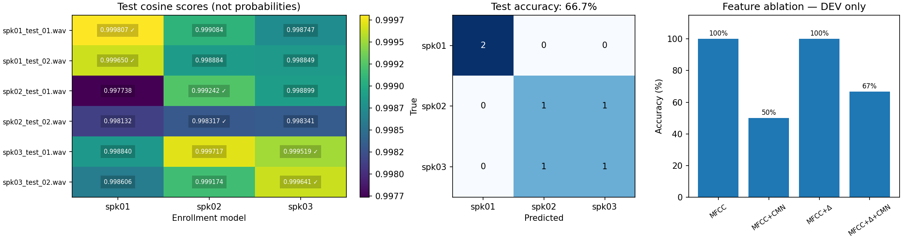
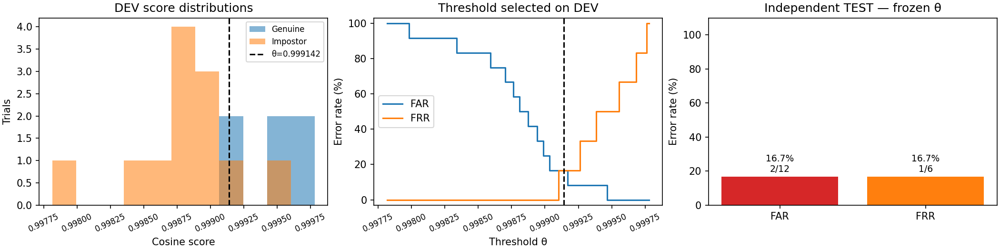
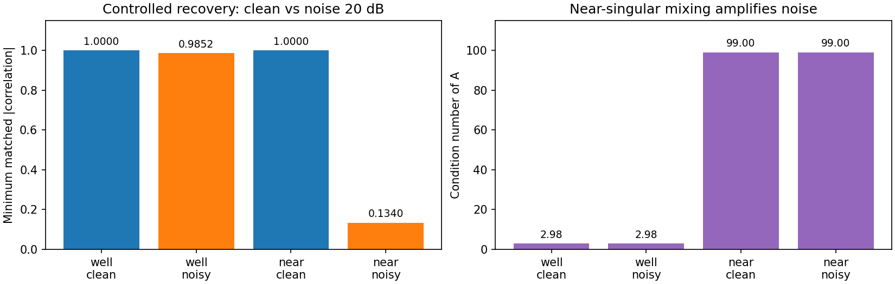
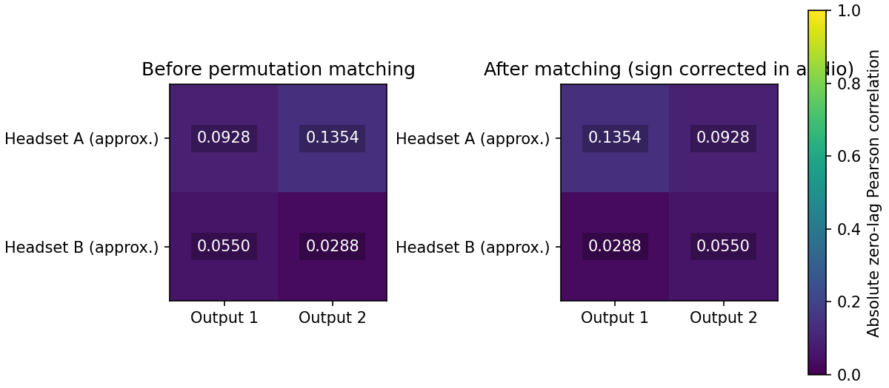

# Báo cáo Lab 5 — Speech enhancement, speaker recognition và source separation

1. Mục tiêu, dữ liệu và phương pháp

## 1. Mục tiêu, dữ liệu và phương pháp

Thực hiện ba khối: làm sạch tiếng nói bằng spectral subtraction (SS) và Wiener; nhận dạng/xác thực người nói bằng MFCC–cosine; tách hai nguồn bằng FastICA. Notebook chính chạy xuyên suốt, thuật toán nằm trong src; dữ liệu và kết quả có manifest/config.

Dữ liệu và phân chia

Phần enhancement giữ 7 clip FSDD (6 dev + 1 reference), nguồn 8 kHz ghép chữ số rồi resample 16 kHz. Noise ESC-50: mưa và máy hút bụi, không gọi là nhiễu quạt. Phần speaker dùng AMI EN2009d tự nhiên: 3 người × (4 enroll + 2 dev + 2 test), 24 clip dài 2,33–3,87s. Preview 23,28s không trùng thời gian enroll/dev/test; 5 lượt đơn dài ≥1s cho 16,774s đánh giá, bỏ 4,698s overlap và các đoạn im lặng/ngắn. Các split cùng một phiên thu, không đại diện kiểm tra khác phiên.

Tham số và công thức chính

Mono 16 kHz; Hann 400 mẫu, hop 160, FFT 512. Tạo y=s+αv với α=√[Ps/(Pv·10^(R/10))], R=0/5/10 dB. SNR_out=10log10[Σs²/Σ(s−ŝ)²]. Dùng chung gain cho reference/outputs; kiểm tra SNR trên PCM16 đọc lại, dung sai ±0,2 dB.

SS quét β=1/1,5/2 và γ=0/0,01/0,05 trên dev; chọn β=2, γ=0.01. Noise PSD tự ước lượng từ 20% frame năng lượng thấp của noisy, bù bias ×1,2; không nhận noise gốc, α hay clean. SS làm mượt power rồi trừ phổ, giữ pha noisy. Wiener dùng H=ξ/(1+ξ), decision-directed 0,9, amplitude floor 0,05; đây là cải tiến bộ ước lượng của Wiener baseline.

MFCC: pre-emphasis 0,97, 40 Mel HTK, log-power, DCT-II ortho; 20 hệ số có c0. Mean/std MFCC và delta 9 frame → 40/80 chiều, L2. Model=mean 4 enrollment embeddings rồi L2. Feature/threshold chọn trên dev, khóa trước test. FastICA: 2 components, unit-variance whitening, seed=0, max_iter=2000, tol=1e−5; chỉ nhận hai quan sát.

2. Enhancement và tích hợp trên hội thoại

## 2. Enhancement và tích hợp trên hội thoại

FSDD: ΔSNR trung bình qua 0/5/10 dB — mưa: SS 7.52, Wiener 7.41 dB; máy hút bụi: SS 4.68, Wiener 5.38 dB. Dev SS tốt nhất đạt mean SNR_out 10.536 dB.

Áp SS/Wiener lên TOÀN BỘ hội thoại trước khi cắt cùng 5 lượt để nhận dạng. Model, feature và θ giữ nguyên; không dùng lịch nói để khử nhiễu. Bản thu gốc có âm phòng, vì vậy không báo “SNR sạch” cho xử lý trực tiếp; SNR chỉ báo khi thêm noise có kiểm soát so với chính bản gốc.

Trên bản gốc: ID Raw 3/5 → SS 4/5 → Wiener 5/5. Tuy nhiên FRR của cùng 5 genuine trials tăng 40% → 60% với θ cố định: thứ hạng đúng không có nghĩa score vượt ngưỡng.

Thêm mưa 5 dB vào hội thoại: SNR Wiener 13.93 dB, nhưng ID 0% → 0%. Trên 6 test clip, máy hút bụi 5 dB: ID 33.3% → 50.0%. Enhancement có thể giúp một số tình huống nhưng không luôn giúp nhận dạng.

SNR không đo độ tự nhiên. PSD và audio A/B được xuất kèm để đối chiếu; không gán điểm nghe chủ quan khi chưa có đánh giá nghe độc lập. Tăng β giảm nền nhưng có thể méo; γ giữ nền phổ để hạn chế musical noise. Không chọn lại tham số theo kết quả tích hợp.

3. Speaker identification và verification

## 3. Speaker identification và verification

Dev chọn MFCC+Δ không CMN. Test identification: 4/6=66.7%; spk01 đúng 2/2, spk02 và spk03 nhầm nhau mỗi người một clip. MFCC-only và MFCC+delta cùng 100% dev, delta thắng tie-break margin rất nhỏ; không khẳng định delta luôn tốt hơn.

CMN tốt nhất trên dev chỉ 66,7%, so với 100% khi không CMN; trừ mean có thể bỏ speaker cue. Enrollment 1/2/4 clip có dev accuracy 66,7%/100%/100%; margin không tăng đơn điệu. Cosine gần 1 do c0/thống kê chung chi phối hướng vector, không phải xác suất đúng.

Verification chọn θ=0.999142 trên dev bằng gần FAR=FRR. Test: FAR=2/12=16.7%; FRR=1/6=16.7%. Một clip tạo 1 genuine + 2 impostor, tổng 18 trial; không tính 18 trial thành 18 clip identification.

Tích hợp trên 6 test clip bản gốc: accuracy Raw/SS/Wiener đều 66.7%, nhưng FRR tăng từ 16.7% lên 50.0%. Khi nhiễu mạnh, FAR=0 có thể chỉ vì hệ thống từ chối tất cả (FRR=100%), không phải verification đã tốt hơn. Tất cả score, claim và lỗi được lưu CSV; mô hình không học từ test/preview.

4. ICA: kiểm chứng và giới hạn thu thực tế

## 4. ICA: kiểm chứng và giới hạn thu thực tế

Hai solo 3s từ cùng preview được chuẩn hóa RMS, tạo X=AS. A tốt=[1.00, 0.60; 0.40, 1.00], det=0,76, cond≈2,98; A gần suy biến=[1.00, 0.98; 0.98, 1.00], det=0,0396, cond=99. File config.json lưu số thực/ma trận không mơ hồ. A và nguồn gốc chỉ dùng tạo/chấm dữ liệu; ICA không nhận chúng.

Min matched |ρ|: well_clean 0.99996; well_noisy 0.98517; near_clean 0.99996; near_noisy 0.13401. Ma trận gần suy biến không nhất thiết thất bại trong điều kiện không nhiễu, nhưng khuếch đại sai số mạnh khi thêm noise 20 dB. Ghép output một-một theo |ρ|, chỉ đổi thứ tự/dấu sau fit.

Thu thật: Array1-01/05 đồng bộ 23,28s là hai đầu vào khác nhau; headset-0/1 chỉ tham chiếu gần đúng. FastICA hội tụ 30 vòng nhưng |ρ| waveform trung bình chỉ 0.095; RMS-envelope correlation 0.588/0.353. Các số waveform nhạy delay/đáp ứng phòng; không gọi là clean SNR hay speaker accuracy.

Chưa có bằng chứng tách sạch hai người trong phòng thật. Reverberation tạo trộn có chập và noise; ICA tức thời có thể tìm thành phần độc lập không tương ứng từng người. Một mic mono không đủ cho ICA 2×2; nhân đôi kênh bị từ chối vì rank thấp. Đây là giới hạn mô hình, không lấy hội tụ làm bằng chứng chất lượng.

5. Trả lời câu hỏi báo cáo 1–6

## 5. Trả lời câu hỏi báo cáo 1–6

1. Vì sao giữ phase noisy? Giới hạn ở SNR thấp?

Noise PSD chỉ cung cấp thông tin công suất, không cho phase sạch. Dùng phase noisy cho phép tái tạo trực tiếp sau khi sửa magnitude. Ở SNR thấp phase quan sát có thể khác phase speech đáng kể, nên dù sửa magnitude đúng vẫn còn méo và không khôi phục được tín hiệu sạch hoàn toàn.

2. Vai trò β và γ? Vì sao tăng β có thể méo tiếng?

β điều khiển mức trừ noise PSD: lớn hơn triệt nhiều năng lượng hơn nhưng cũng dễ xóa speech yếu khi phổ chồng lấn hoặc PSD ước lượng sai. γ là power floor tương đối với noise, hạn chế lỗ phổ sâu/musical noise nhưng giữ residual noise. Bản cài thêm smoothing và chặn gain ≤1; không coi SNR tăng là chất lượng nghe tăng.

3. Ý nghĩa Wiener H=Ps/(Ps+Pv)?

Ở vùng speech-dominant Ps≫Pv thì H gần 1, giữ tín hiệu; ở vùng noise-dominant H gần 0, làm suy giảm. Thực tế phải ước lượng Ps và Pv; code dùng noise estimate từ noisy và speech SNR decision-directed. Smoothing/floor giảm dao động gain nhưng không bảo đảm tách sạch hoặc giữ mọi phụ âm.

4. Vì sao căn chỉnh trước SNR_out? Delay 10 ms gây gì?

SNR so sánh từng mẫu nên reference/output phải cùng độ dài, thời điểm và mức gain tham chiếu. Delay 10 ms tương ứng 160 mẫu ở 16 kHz thường làm sai số tăng và SNR đo thấp giả tạo, kể cả waveform không bị méo. Hướng chính xác phụ thuộc tự tương quan tín hiệu; không có mức giảm cố định. STFT/ISTFT hiện tại giữ căn chỉnh và độ dài.

5. Identification khác verification thế nào?

Identification chọn argmax cosine giữa các người đã enrollment, output là nhãn và chấm accuracy/confusion matrix. Verification kiểm tra một claim bằng ngưỡng, output accept/reject, chấm FAR/FRR trên genuine/impostor. Clip có thể ID đúng nhưng vẫn chấp nhận thêm claim sai nếu cả hai score vượt ngưỡng.

6. Vì sao không chọn threshold trên test? FAR–FRR trade-off?

Chọn θ bằng test làm rò rỉ nhãn đánh giá vào thiết kế, tạo kết quả lạc quan. Dev được dùng chọn θ rồi khóa trước test. Tăng θ thường giảm FAR nhưng tăng FRR. Với ít trial, các đường có bậc thang; ngưỡng gần FAR=FRR là minh họa operating point, không phải EER liên tục chính xác.

6. Trả lời câu hỏi 7–12 và kết luận

## 6. Trả lời câu hỏi 7–12 và kết luận

7. MFCC vẫn chứa thông tin người nói vì sao?

MFCC mô tả bao phổ liên quan đáp ứng ống thanh, cộng hưởng và đặc điểm phát âm, những yếu tố khác nhau giữa người. Mean/std có thể giữ khác biệt thống kê đó. Nhưng MFCC còn phụ thuộc nội dung, âm lượng, kênh và noise; vector mean/std không phải speaker embedding hiện đại, nên score cao vẫn có thể xếp nhầm người.

8. CMN vừa hữu ích vừa bất lợi như thế nào?

Trừ mean cepstrum có thể giảm thành phần kênh gần cố định trong miền log-spectrum. Nhưng baseline này dùng chính mean MFCC làm một phần vector; CMN làm các chiều đó gần 0 và có thể xóa speaker cue. Trong dữ liệu hiện tại best dev accuracy có CMN 66,7%, không CMN 100%; không khái quát rằng CMN luôn kém.

9. Vì sao ICA không biết thứ tự/biên độ tuyệt đối?

Hoán vị các nguồn hoặc nhân nguồn với hằng số khác 0 rồi bù vào cột ma trận trộn vẫn tạo cùng quan sát. Vì thế độc lập không xác định được thứ tự, dấu hay scale. Matching |ρ| một-một và đảo dấu chỉ để đánh giá; không đưa reference vào quá trình fit, không dùng A⁻¹ để thay output.

10. Hai hàng A gần tỷ lệ nhau gây gì?

Hai microphone mang thông tin gần trùng nhau; A có condition number lớn, gần mất khả nghịch. A suy biến thực sự thì không có đủ phương trình độc lập. Khi gần suy biến, noise/rounding dễ khuếch đại. Case cond=99 vẫn có |ρ|≈0.99996 khi sạch, nhưng nguồn kém nhất chỉ 0.134 khi thêm noise 20 dB.

11. Instantaneous mixing khác phòng vang?

Trộn tức thời dùng hệ số cố định nhân cùng mẫu thời gian. Phòng thực có nhiều đường truyền, trễ và phản xạ, nên từng cặp nguồn–mic cần bộ lọc h_ij và phép chập. FastICA tức thời không mô hình hóa chúng. Headset cũng có crosstalk/noise; chỉ đối chiếu gần đúng, không coi là clean ground truth.

12. Enhancement có luôn cải thiện speaker recognition?

Không. Trên 5 lượt preview gốc, ID tăng 60%→80%→100% (Raw/SS/Wiener), nhưng chỉ là demo nhỏ. Với mưa 5 dB, SNR Wiener đạt 13.93 dB mà ID vẫn 0/5. Trên 6 test clip bản gốc, ID giữ 4/6 nhưng FRR tăng 16,7%→50% sau Wiener với θ khóa. Noise residual, thay đổi thống kê cepstrum và mismatch enrollment/test có thể làm hại nhận dạng/xác thực.

Ba kết luận có số liệu

1) Denoise có thể giúp demo gốc (ID 3/5→5/5) nhưng không luôn giúp khi thêm noise. 2) SNR 13.93 dB không bảo đảm ID: mưa 5 dB vẫn 0/5. 3) ICA phụ thuộc mô hình/điều kiện: well_clean |ρ|≈0.99996, near_noisy min |ρ|≈0.134; thu thật chưa tách sạch.

Nguồn: đề CSE457 Lab 5; Huang–Acero–Hon (2001); Rabiner–Schafer (2010); Ephraim–Malah (1984, decision-directed). Data: FSDD v1.0.10 CC BY-SA 4.0; ESC-50 theo LICENSE upstream; AMI CC BY 4.0. URL, attribution và SHA256 trong data/**/README.md/manifest.json. Chạy lại: notebooks/Lab5.ipynb hoặc .venv/bin/python tools/run_lab.py.
